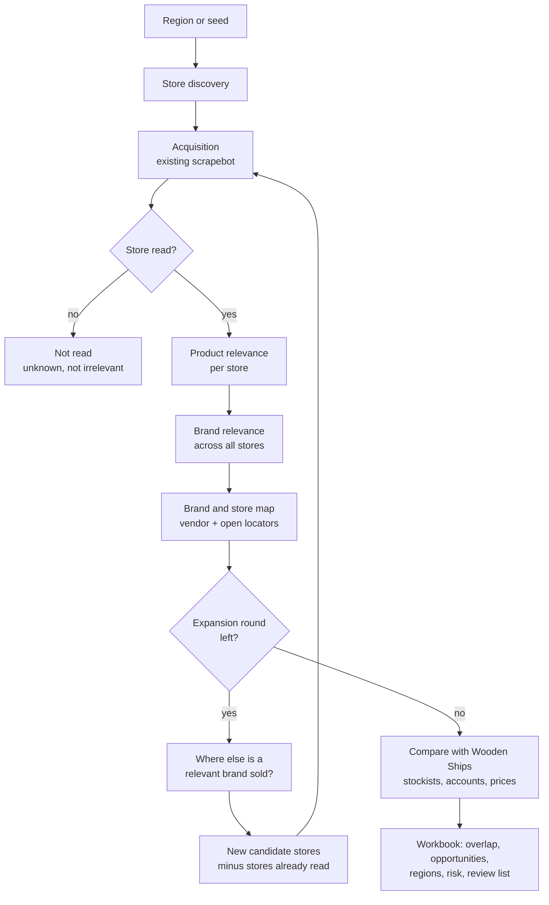

# PRD — Competitive and Retailer Analysis

| | |
|---|---|
| **Version** | 0.1 (draft) |
| **Date** | 12 October 2026 |
| **Status** | Draft for review. Nothing in this document is built yet |
| **Product owner** | _(fill in the owner's name)_ |
| **Extends** | [PRD — Scrapebot](prd.md), section 3 ("Competitor or partner analysis: next phase, with its own PRD") and [ADR 0011](../decisions/0011-wholesale-analysis-stage.md) |
| **Technical documents** | [ADR 0012](../decisions/0012-brand-store-map-from-the-retailer-side.md) · [Architecture](../architecture/overview.md) · [Roadmap](../planning/roadmap.md) |

---

## 1. Summary

Wooden Ships wants to know where brands like its own are sold, which of those stores
it already sells to, and where the gaps are. Brands rarely publish their retailer
lists, so this phase reads the answer from the other side: every store the bot scrapes
names the brands it sells, and turning that around gives the stores of each brand.
Where a brand does publish a store locator the bot is allowed to read, that list is
added. The result is one table of brand and store pairs, compared with Wooden Ships'
own stockists and accounts, and a workbook that answers: which stores overlap, which
stores carry similar brands but not us, which regions are thin, and which brands sit
closest to us.

## 2. Problem and business outcomes

**Problems today:**

1. `scrapebot analyze` scores each store on its own. It does not show a brand's
   retailers as a group, or compare that group with ours.
2. The wholesale team picks which brands to watch by judgement. Nothing ranks brands
   by how close they are to Wooden Ships.
3. Discovery searches for knitwear stores. Stores that carry a similar brand but did
   not match a knitwear search are never found.

**Target business outcomes:**

| Outcome | Measure |
|---|---|
| A list of stores to contact, with the reason | Stores that carry relevant brands and are not Wooden Ships customers, ranked, each with its evidence |
| Regions to prioritise | Per state or province: retailers of relevant brands against Wooden Ships stockists |
| A watch list of brands chosen from data | Brands ranked by relevance, checked against a list the wholesale team labelled |
| Known risk in our own accounts | Current Wooden Ships retailers that also carry highly similar brands |

## 3. What was measured before writing this

All numbers are from run `20261009T073717823Z-e4d60c` (808 stores, 287 readable) and
from public pages read on 12 October 2026. None of it is in the code: the counts from
the run can be reproduced with the [process notebooks](../../process/README.md), the locator
checks were one-off scripts.

**The retailer side already answers part of the question.** Counted from `vendor` in
the full `products` table:

| Brand | Stores selling it | Of those, already Wooden Ships |
|---|---:|---:|
| Z Supply | 36 | 2 |
| Rails | 29 | 1 |
| White + Warren | 18 | 1 |
| Lilla P | 15 | 1 |
| At least one of the four | 67 | 3 |

Of the 67 stores, 59 are retail partner candidates not matched to a stockist, 42 of
them with an email address. Of the 32 that could be located, 17 have a Wooden Ships
stockist within 15 miles and 15 do not. 26 stores carry two or more of the four.

**Store locators are the exception, not the rule.**

| Checked | Result |
|---|---|
| The four brands named in the proposal | None gives a list the bot may read. Z Supply's locator is fed by Storemapper, whose data host disallows all crawlers in `robots.txt`. Rails lists only its own shops. White + Warren removed its locator (a Stockist.co widget until at least January 2025; the page is now 404). Lilla P's locator page is empty |
| 24 brands most carried by stores in the run | 4 use Stockist.co, 1 Storemapper, 5 have a stores page with no recognised locator widget (own shops or a short list; not examined further), 6 have no locator, 8 could not be checked (the site refused, or the guessed domain was wrong) |
| 3 Stockist.co feeds | Heartloom returns its whole list in one request. Habitat and Joseph Ribkoff have that turned off: they give pin coordinates (Habitat: 1,151) and search by area only |

**A full locator gives a different and larger picture.** Heartloom's feed holds 415 US
retailers with name, address and coordinates, but no website or phone. Against the 500
stockists in `stockists.json`:

| Group | Stores |
|---|---:|
| Same store as a Wooden Ships stockist (name agrees, within 1 mile) | 29 |
| Same name and state, different place: to check by hand | 2 |
| Not ours, a stockist within 15 miles | 264 |
| Not ours, no stockist within 15 miles | 120 |

By state the gap is visible at once: Louisiana 21 Heartloom retailers against 3
stockists, New York 49 against 30, Illinois 20 against 11. Only 3 of the 415 stores
were in the 808-store run, and of the 17 stores seen selling Heartloom through
`vendor`, 1 was found in the locator. The two sources complement each other.

**Two findings about our own data:**

- The `brands` column of the analysis `stores` sheet holds 15 brands per store.
  Counting from it gives 22 stores for Z Supply instead of 36. The map must be built
  from the `products` table.
- Name normalisation already merges "White & Warren", "WHITE+WARREN" and "White +
  Warren". It does not merge sub-lines ("Z Supply Lounge") or "White and Warren".

## 4. Users and main scenario

| User | Need |
|---|---|
| **Wholesale team** | A ranked list of stores to contact and the regions to work, with evidence they can check |
| **Operator** | Run the analysis without writing code, and re-run it when an input changes |
| **Reviewer** | See which matches and labels the rules were unsure about |

### Main scenario

1. The operator fills the reference files: stockists, the Salesforce account export,
   Wooden Ships' price points, and the brands to watch (or accepts the ranked list).
2. The operator picks a region and runs discovery and a scrape as today.
3. The analysis ranks brands by relevance and builds the brand and store map from the
   scraped catalogues and from the locators that are open.
4. For the relevant brands, the operator starts one expansion round: the bot looks for
   more stores that carry them, skips stores already read, and scrapes the new ones.
5. The analysis is run again. The workbook shows overlap, opportunities, regional gaps
   and brand risk, each row with its source and confidence.
6. A reviewer checks the rows marked for review. The wholesale team works the list.

## 5. Scope

### 5.1 In scope

- A table of brand and store pairs, with the source of each pair.
- Relevance of products, brands and stores to Wooden Ships, with every component of a
  score kept visible.
- Reading brand store locators where the data host's `robots.txt` allows it and the
  feed gives the whole list.
- One bounded round of looking for more stores of relevant brands.
- Matching locator stores to Wooden Ships stockists and accounts, and to scraped stores.
- Overlap, opportunity, regional gap and brand risk tables in the analysis workbook.

### 5.2 Out of scope

| Item | Reason |
|---|---|
| Reading a locator whose data host disallows crawlers | [ADR 0002](../decisions/0002-camoufox-for-rendering-only.md). Rendering the page in the browser to capture the same feed is the same request and is also out |
| Rebuilding a list by searching area after area where the brand turned "list all" off | The brand chose not to publish the list as a whole. Pin coordinates may still be counted per state |
| Wholesale marketplaces (Faire, JOOR, NuORDER) | They need a login |
| Opening Instagram or Facebook profiles | [ADR 0008](../decisions/0008-store-discovery-paid-search.md) |
| Currency conversion | Prices stay as written; price comparison uses US-dollar prices only ([ADR 0011](../decisions/0011-wholesale-analysis-stage.md)) |
| Customer and order data in this repository | Accounts and sales reach the analysis as files in `data/inputs/`, which is never committed |
| Reachout | Later, as in the main PRD |

## 6. The flow

Three points the diagram fixes:

- A store has three outcomes, not two. In the measured run 521 of 808 stores were not
  read; they are unknown, and must not be filed as irrelevant.
- A product is judged inside its store. A brand is judged only after its products are
  gathered from every store, and only with enough evidence.
- The loop has a way out. By default it runs once.

## 7. Functional requirements

Priorities as in the main PRD: **Must**, **Should**. Numbers given as defaults are
proposals to confirm ([section 12](#12-assumptions-and-open-questions)).

### 7.1 Reference data

| ID | Requirement | Priority | Acceptance criteria |
|---|---|---|---|
| RF-01 | The analysis reads the operator's files as today: stockists, accounts, brands, price points | Must | A missing file is named in the analysis README and its part of the result is left out, not guessed |
| RF-02 | `brands.csv` may carry a brand's website and its aliases | Must | "Z Supply Lounge" counts as Z Supply when listed as an alias |
| RF-03 | A Wooden Ships profile (product types, materials, price range) is built from the price points and from Wooden Ships' own catalogue | Should | The profile is written to the analysis output so a person can read what brands are compared with |

### 7.2 Relevance

| ID | Requirement | Priority | Acceptance criteria |
|---|---|---|---|
| RL-01 | Product relevance has four parts, each its own column: knitwear (the existing strict rule, which is the gate), similar category, similar material, and price inside a band around Wooden Ships' price for that category. A part that cannot be read is `unknown`, never a "no" | Must | No change to the `products` table; relevance is derived. On the measured run category is known for 97% of knitwear products and material for 72% |
| RL-08 | The price band is set against Wooden Ships' own Shopify catalogue, retail against retail, in US dollars. Its width is a setting ([Q-10](#12-assumptions-and-open-questions)). Today price fit exists per store only: the store's knitwear median against our retail price, "fits" from 0.75 to 1.35 times | Must | The band and the reference price appear in the analysis README |
| RL-02 | Brand relevance is computed across all stores that carry the brand, from separate components: knitwear share, number of stores, how often it is sold beside Wooden Ships or in Wooden Ships accounts, price position, and similarity of product types, tags, titles and materials to the Wooden Ships profile | Must | Every component is a column; the rank can be recomputed by hand from them |
| RL-03 | A brand is ranked only with enough evidence. Default: at least 8 stores and 30 products | Must | Brands below the floor are listed as "not enough data" |
| RL-04 | A brand the operator lists in `brands.csv` keeps the operator's label whatever the rank says | Must | The operator's label and the computed rank appear side by side |
| RL-05 | A store that was not read is reported as unknown, apart from stores judged not relevant | Must | The three counts are in the README |
| RL-06 | A gold set of about 30 brands labelled relevant or not by the wholesale team. Every change to the ranking method is measured against it | Must | The README states agreement with the gold set |
| RL-07 | Text similarity starts with TF-IDF over structured fields. Sentence embeddings are added only if the gold set shows TF-IDF misses relevant brands | Should | A measured comparison precedes the dependency |

### 7.3 Brand and store map

| ID | Requirement | Priority | Acceptance criteria |
|---|---|---|---|
| MP-01 | One row per brand, store and source in `brand_stores` | Must | The four brands of section 3 give the store counts measured there, within alias differences |
| MP-02 | Sources: `vendor` (scraped catalogue) and `locator` (brand's published list) | Must | A pair seen in both has two rows |
| MP-03 | Built from the full `products` table | Must | No dependence on the 15-brand `brands` column |
| MP-04 | Brand names are merged by the existing normalisation plus the alias list | Must | Spellings found in section 3 merge into one brand each |
| MP-05 | Brands read from a store's "brands" or "designers" page, for stores without a product feed | Should | Source `brands_page`, flagged for review |
| MP-06 | The map can be built over more than one run | Should | A store read in two runs counts once per brand |

### 7.4 Store locators

| ID | Requirement | Priority | Acceptance criteria |
|---|---|---|---|
| LC-01 | A locator survey per brand: find the page, name the widget provider, and record one status: `full_list`, `area_search_only`, `robots_disallowed`, `own_shops_only`, `none`, `unreachable` | Must | The survey table is in the workbook |
| LC-02 | `robots.txt` is checked on the host that serves the data, not only on the brand's site | Must | Test: a brand page that is allowed with a data host that is disallowed is not read |
| LC-03 | A reader per provider, only for feeds with status `full_list`. First provider: Stockist.co | Must | Heartloom's feed reproduces the 415 locations of section 3 from a recorded fixture |
| LC-04 | The list is stored as found (name, address, city, state, postal code, country, coordinates, and website or phone where given), with brand, provider, URL and fetch time | Must | Raw values unchanged |
| LC-05 | A request cap and a disk cache per brand | Must | Repeating the survey with the same list makes no request |
| LC-06 | For `area_search_only`, pin coordinates may be read to count locations per state. Names are not collected by repeated search | Should | No more than the widget's own overview request |
| LC-07 | A locator the brand has withdrawn from its site is not read | Must | A 404 locator page gives status `none` |

### 7.5 Expansion round

| ID | Requirement | Priority | Acceptance criteria |
|---|---|---|---|
| EX-01 | For relevant brands, look for more stores with discovery's existing brand search (`brands`, `agent.brand_tasks`, `web_search.brand_queries`) | Must | No new search source |
| EX-02 | Sources are used cheapest first: data already held, open locators, then paid search | Must | The report shows stores found per source |
| EX-03 | New candidates are compared with stores already read in earlier runs before any request | Must | A store read within the cache age is not fetched again |
| EX-04 | A stop rule: one round by default, with caps on brands and on new stores per round | Must | The run ends at the cap and reports what was left out |
| EX-05 | Candidates outside the chosen region are kept and flagged. Default: they are not scraped | Must | The operator can turn scraping outside the region on |
| EX-06 | Locator stores without a website get the existing website lookup, capped | Should | `website_source` = `lookup` |

### 7.6 Matching stores

| ID | Requirement | Priority | Acceptance criteria |
|---|---|---|---|
| ER-01 | A locator store is matched to stockists, accounts and scraped stores by domain, then phone, then name with place | Must | `match_method` on every match |
| ER-02 | A name match counts only with place: same postal code or within 1 mile. Same name and state only is `check`, not a match | Must | "The Hive" in two cities stays two stores |
| ER-03 | Loose name matching (spelling variants, abbreviations) is used only together with place | Should | Fixtures of real name pairs |
| ER-04 | Every match has a confidence, and unsure matches go to a review sheet | Must | The 2 Heartloom cases of section 3 land on the review sheet |

### 7.7 Analysis

| ID | Requirement | Priority | Acceptance criteria |
|---|---|---|---|
| AN-01 | Overlap per brand: stores shared with Wooden Ships, stores the brand has and we do not | Must | Sheet `brand_overlap` |
| AN-02 | Opportunities: stores that are not ours, ranked by relevant brands carried, the existing store score and territory status | Must | Sheet `opportunities`, best first, with reasons |
| AN-03 | Regional gaps per state or province: retailers of relevant brands, Wooden Ships stockists, and stores with no stockist inside the territory radius | Must | Sheet `regions` |
| AN-04 | Brand closeness: share of retailers in common between each brand and Wooden Ships, and between brands | Must | Reported with the number of stores behind it |
| AN-05 | Brands sold together more often than chance | Should | Only for pairs with enough stores |
| AN-06 | Brand risk: how many of our customers also carry the brand, how much knitwear of it they hold, its price position against ours, and its presence in our territories | Must | Components shown separately; no single number without them |
| AN-07 | Current Wooden Ships retailers that carry highly similar brands | Must | A filter of the `stores` sheet |
| AN-08 | Every row has its source, evidence and confidence | Must | Columns exist on every new sheet |
| AN-09 | Coverage is stated per brand: a full published list, or a sample seen in catalogues | Must | A sample is never shown as a share of the brand's retailers |

### 7.8 Output

| ID | Requirement | Priority | Acceptance criteria |
|---|---|---|---|
| RP-01 | New sheets in the analysis workbook: `brand_stores`, `brands_ranked`, `brand_overlap`, `opportunities`, `regions`, `brand_risk`, `locator_survey`, `review` | Must | Same content in the CSV folder |
| RP-02 | The README lists the inputs used and lacking, the coverage per brand and the gold set agreement | Must | Readable without opening the workbook |
| RP-03 | The web interface shows the opportunities and regions | Should | Labels in English, as the rest of the interface |

## 8. Data model

New tables, all derived; the run's raw tables are not changed.

| Table | One row per | Key columns |
|---|---|---|
| `brand_stores` | brand, store and source | `brand`, `brand_key`, `store_key`, `domain`, `store_name`, `city`, `state`, `country`, `lat`, `lng`, `source` (`vendor`, `locator`, `brands_page`), `evidence_url`, `seen_at`, `products`, `knit_products` |
| `brands_ranked` | brand | `brand`, `stores`, `knit_share`, `with_wooden_ships`, `price_position`, `text_similarity`, `rank`, `operator_label`, `enough_data` |
| `brand_overlap` | brand | `brand`, `coverage` (`full_list`, `sample`), `stores`, `shared`, `not_ours`, `not_ours_open_territory`, `closeness` |
| `opportunities` | store | `store_key`, `relevant_brands`, `score`, `reasons`, `nearest_stockist_miles`, `contact`, `source`, `confidence` |
| `regions` | state or province | `region`, `brand_retailers`, `stockists`, `open_territory_stores`, `brands` |
| `brand_risk` | brand | `brand`, `customers_carrying`, `knit_products_there`, `price_position`, `territories_shared` |
| `locator_survey` | brand | `brand`, `website`, `locator_url`, `provider`, `status`, `locations`, `checked_at` |
| `review` | unsure match or label | `kind`, `left`, `right`, `reason` |

## 9. Nonfunctional requirements

| Aspect | Requirement |
|---|---|
| **Ethics** | As the main PRD: `robots.txt` respected on every host read, public pages only, no login, no bypass |
| **Raw stays raw** | Normalisation and matching live in the analysis. Acquisition and locator files keep values as found |
| **Privacy** | Stockists, accounts and sales stay in `data/`, which is never committed |
| **Cost** | Every paid search keeps its cap and cache. The expansion round reports its cost |
| **Traceability** | Every pair, match and score names its source and evidence |
| **Testing** | No network in tests: recorded locator feeds and a recorded run slice |
| **Structure** | The pipeline and the analysis do not import the API or the interface |

## 10. Release plan

Each stage ends with a small real trial and a person reading the output, as in the
main PRD.

| Stage | Content | Exit gate |
|---|---|---|
| **C0. Inputs** | `brands.csv` with the brands to watch, `accounts.csv`, `price_points.csv`; gold set of about 30 brands (RF-01, RF-02, RL-06) | `scrapebot analyze` fills the peer and competitor columns on the measured run |
| **C1. Map and overlap from what we hold** | `brand_stores` from `vendor`, overlap and opportunities (MP-01 to MP-04, AN-01, AN-02, AN-08, AN-09) | The four brands of section 3 reproduce; a person checks 30 rows |
| **C2. Brand relevance** | Ranking with separate components, evidence floor (RL-01 to RL-06) | Agreement with the gold set reviewed with the wholesale team |
| **C3. Locators** | Survey and the Stockist.co reader, matching by name with place (LC-01 to LC-05, LC-07, ER-01, ER-02, ER-04) | Heartloom reproduces from a fixture; the review sheet is checked by hand |
| **C4. Expansion round** | One round in one region (EX-01 to EX-05) | Stores found per source and cost reported; no store read twice |
| **C5. Regions and risk** | Regional gaps, closeness, brand risk (AN-03, AN-04, AN-06, AN-07) | The wholesale team confirms the risk definition and uses the list once |

## 11. Success metrics

| Metric | Target | Type |
|---|---|---|
| Requests that break `robots.txt`, on any host | 0 | Hard |
| Rows in `brand_stores` without a source and evidence | 0 | Hard |
| Paid requests over a cap | 0 | Hard |
| Matches marked as the same store that a person finds wrong, on a checked sample | ≤ 5% | Proposed |
| Agreement of the brand ranking with the gold set | ≥ 80% | Proposed |
| Opportunities the wholesale team accepts as worth contacting, on a checked sample | Set after the first review | Proposed |

## 12. Assumptions and open questions

### Assumptions

- **A-01.** This phase is a stage of scrapebot, not a separate project
  ([ADR 0012](../decisions/0012-brand-store-map-from-the-retailer-side.md)).
- **A-02.** "Relevant brand" means two different things that are listed apart: brands
  that compete on knitwear, and brands that mark the kind of boutique that suits us.
  Rails and Z Supply are the most carried brands in the run (29 and 36 stores) but
  hold 12% and 15% knitwear, so they are markers, not knitwear rivals.
- **A-03.** The results for a brand without a full published list are a sample of the
  stores we happened to read. They support "which stores" and "which brands go
  together"; they do not support a share of that brand's retailers.

### Open questions

| No. | Question | What it affects |
|---|---|---|
| Q-01 | Who labels the gold set, and by when? | RL-06, stage C2 |
| Q-02 | Is A-02 right: two lists, rivals and markers? | RL-02, the sheets of RP-01 |
| Q-03 | What does the wholesale team mean by a brand being a risk? Are the four components of AN-06 the right ones? | AN-06 |
| Q-04 | What is the territory radius, and are gaps reported per state or per metro area? | AN-03 |
| Q-05 | When is `accounts.csv` available? Without it "not ours" is measured against the stockist list only | AN-01, AN-02, AN-06 |
| Q-06 | May the expansion round scrape stores outside the chosen region? | EX-05 |
| Q-07 | Are the defaults of RL-03 (8 stores, 30 products) and of section 3 (25% knitwear) acceptable floors? | RL-03 |
| Q-08 | Which brands beyond the four should the locator survey cover? Checking every brand carried by 10 or more stores means 112 brands | LC-01, stage C3 |
| Q-09 | What is the wholesale orders project, and does it supply the account and sales files? | RF-01 |
| Q-10 | The operator asked for a price range of "50–60% of the price of our Shopify products". Does that mean a product may be up to 50–60% cheaper or dearer than ours, or that it should cost 50–60% of ours? Read literally, the second rejects a product priced the same as ours | RL-08 |

## 13. Glossary

| Term | Meaning |
|---|---|
| Brand and store map | The table of which brand is sold in which store, with where each pair was seen |
| Coverage | Whether a brand's stores come from its full published list or from a sample of catalogues |
| Expansion round | One pass of finding more stores that carry relevant brands and scraping them |
| Gold set | Brands labelled by hand, used to measure the ranking |
| Locator | A brand's "find a store" page, usually a widget fed by a third-party service |
| Open territory | A store with no Wooden Ships stockist inside the territory radius |
| Reverse lookup | Asking each store which brands it sells, then turning the answer into the stores of each brand |
